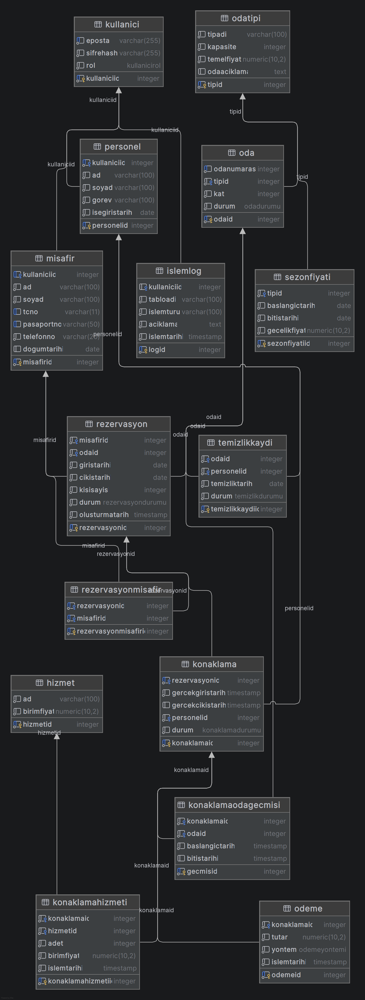

# Otel Rezervasyon ve Konaklama Yönetim Sistemi

Veritabanı Yönetimi dersi dönem projesi.

## Grup Üyeleri
- Ahmet Kutay Bayram - 455134 
- Ahmet Civan Orhan - 455130 

## Kullanılacak Teknolojiler
- **Veritabanı:** PostgreSQL
- **Backend:** Java (Spring Boot)
- **Veritabanı Araçları:** DataGrip, dbdiagram.io

## Proje Durumu ve Dosyalar
- [x] Veritabanı tablo tasarımları 
- [ ] Trigger, Stored Procedure ve View yapıları 
- [x] ER Diyagramı
- [ ] Örnek veri seti (Seed data)
- [ ] Spring Boot Backend bağlantısı
      
## ER Diyagramı

